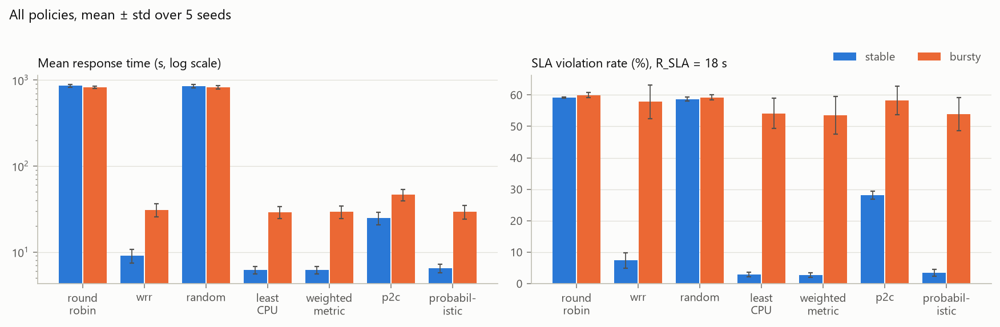
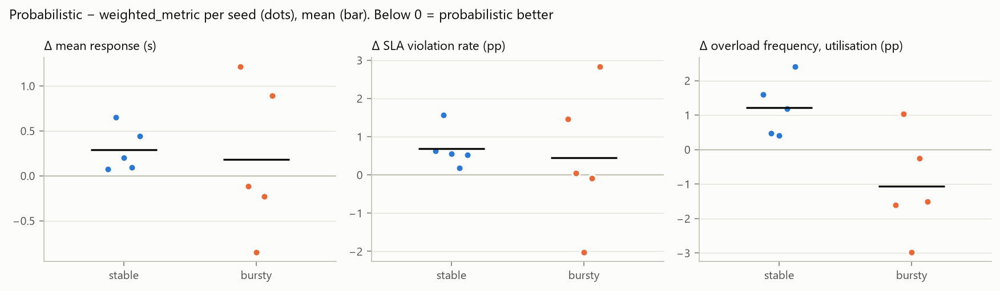
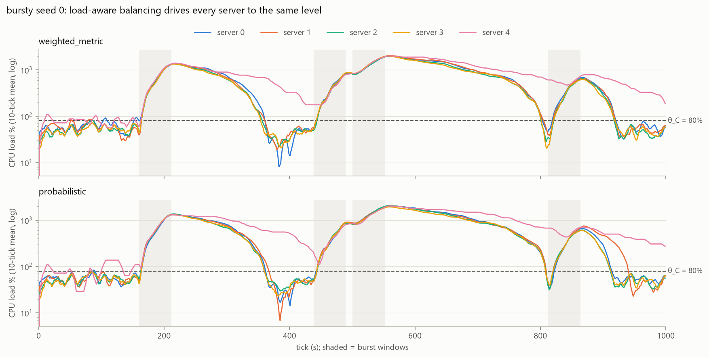

# Uncertainty-Aware Probabilistic Load Balancing

**Repository:** https://github.com/YOUR-GITHUB-USERNAME/uncertainty-aware-load-balancer
<!-- TODO: replace YOUR-GITHUB-USERNAME once the GitHub repo is created -->

M.Tech Cloud Computing project, NIT Warangal (2026). A discrete-time Python simulation compares a load balancer
that scores servers by **estimated overload probability** (from the rolling mean *and variance* of recent
metrics) against six baselines, under stable and bursty workloads.

> **Research question:** can recent server metrics *and their variability* be used to estimate overload risk and
> improve task assignment compared with simple load-balancing policies?

## Headline result

- **Load-awareness matters a lot.** Policies that ignore server state (Round Robin, Random) send work to a slow
  server that builds a hidden backlog. Their mean response is about 850 s, against about 6 s for the load-aware
  policies.
- **The uncertainty term does not help here.** The probabilistic policy is compared, paired by seed, against
  `weighted_metric`, which is the same policy *minus the risk term*. It is slightly worse on stable
  (+0.29 s, 0/5 seeds won). On bursty there is no detectable difference (+0.18 s ± 0.85 s).
- **Why:** a good balancer equalises load, so during bursts every server is far above the threshold at the same
  time. P_risk is then close to 1 everywhere and carries no information for *ranking* servers. The risk estimate
  is well calibrated (predicted 0.74 vs observed 0.72 on bursty) but it does not discriminate between servers.
- **Robust:** a pre-declared sensitivity sweep over θ, the admission threshold, the risk weight and the window W
  finds no setting where the risk term consistently helps.

The full analysis is in [docs/results.md](docs/results.md).

### Results (mean ± std over 5 seeds, R_SLA = 18 s)

| Policy | Stable: mean resp (s) | Stable: SLA viol. | Bursty: mean resp (s) | Bursty: SLA viol. | Bursty: throughput (tasks/s) |
|---|---|---|---|---|---|
| Round Robin | 857 ± 30 | 59.2% | 821 ± 25 | 60.0% | 0.46 |
| Random | 847 ± 40 | 58.7% | 823 ± 35 | 59.2% | 0.46 |
| Weighted RR | 9.1 ± 1.7 | 7.4% | 30.9 ± 5.2 | 57.8% | 3.20 |
| Power of Two Choices | 24.8 ± 4.2 | 28.2% | 46.4 ± 7.3 | 58.2% | 2.76 |
| Least CPU | 6.16 ± 0.61 | 2.9% | 29.2 ± 4.8 | 54.1% | 3.43 |
| Weighted metric (ablation) | **6.15 ± 0.62** | **2.7%** | 29.3 ± 4.9 | **53.5%** | 3.41 |
| **Probabilistic (proposed)** | 6.44 ± 0.74 | 3.4% | 29.5 ± 5.2 | 53.9% | 3.41 |

Under bursts, every policy violates the SLA for over half of all tasks. Offered load reaches about 160% of
capacity during a burst, so no placement rule can avoid queueing.


*Fig 1. Mean response time (log scale) and SLA violation rate for every policy.*


*Fig 2. Probabilistic − weighted_metric for each seed. Below 0 means the risk term helped. The dots straddle 0.*


*Fig 4. Bursty workload, seed 0. During bursts (shaded), all five servers rise together to 10–20× capacity, far
above θ = 80%, so a per-server risk score has nothing to rank.*

## How the proposed policy works

For each incoming task and each server i, over the last W = 10 samples:

```
P_C = 1 − Φ((θ_C − μ_C) / σ_C)          θ_C = 80%,  θ_M = 85%   (σ = 0 → deterministic check)
P_risk = 1 − (1 − P_C)(1 − P_M)         CPU and memory assumed independent
L_i = 0.4·C/100 + 0.4·M/100 + 0.2·r     current load (C, M = load %, r = normalised response time)
S_i = 0.6·L_i + 0.4·P_risk              pick the lowest S_i among servers with P_risk ≤ 0.5
                                        (if none qualify, pick from all and log "capacity pressure")
```

`weighted_metric` is exactly this with the risk term removed. A test proves that setting the weights to (1, 0)
and turning admission off reproduces it decision for decision.

## Experimental setup

- **5 heterogeneous servers**, from (2 cores, speed 0.5) up to (8 cores, speed 2.0).
- **Synthetic tasks** with CPU and memory demands and lognormal work. Poisson arrivals for 1000 s at about 65%
  mean load, then the queue is drained until every task finishes.
- **Two workloads with the same mean load:** stable (gentle sinusoidal drift) and bursty (4 bursts with 3× the
  arrival rate).
- **Fair comparison:** each (workload, seed) task list is generated once and given unchanged to all 7 policies.
  Servers are rebuilt for every run, and randomised policies draw from their own seeded RNG streams.
- **Pre-declared parameters:** θ, the weights, W and R_SLA were fixed before any results were seen, and stayed fixed.
- 7 policies × 2 workloads × 5 seeds = 70 runs (about 30 s). The sensitivity sweep covers 44 points (about 200 s).

## Running it

Requires Python ≥ 3.11.

```powershell
git clone https://github.com/YOUR-GITHUB-USERNAME/uncertainty-aware-load-balancer.git
cd uncertainty-aware-load-balancer
python -m venv .venv
.venv\Scripts\Activate.ps1            # Linux/macOS: source .venv/bin/activate
pip install -r requirements.txt
pip install -e .

python -m pytest -q                   # 156 tests
python -m experiments.run_all         # main matrix   -> results/runs.csv, summary.csv, paired.csv
python -m experiments.sensitivity     # sweep, ~200 s -> results/sensitivity.csv
python -m experiments.plots           # figures       -> results/figures/
```

`results/` is regenerated on every run and is not versioned. The figures in `docs/figures/` are the committed
snapshot that the write-up refers to.

## Repository layout

```
src/lbsim/
  config.py          every tunable parameter (frozen dataclasses)
  workload.py        seeded stable/bursty task generation
  server.py          capacity, running tasks, FIFO queue, utilisation and load signals
  metric_window.py   rolling window (mean, population std)
  scoring.py         pure formulas: L_i, Φ, P_C/P_M, P_risk, S_i
  simulator.py       time-stepped loop shared by every policy
  evaluation.py      metrics, seed aggregation, paired comparison
  sensitivity.py     sweep definition and paired sweep runner
  policies/          one file per policy, all subclassing Policy
experiments/         run_all.py, sensitivity.py, plots.py
tests/               pytest suite (formula edge cases, fairness, determinism)
docs/                spec, architecture, decision log, results, interview notes, figures
```

## Documentation

| File | Contents |
|---|---|
| [docs/results.md](docs/results.md) | Full results write-up: setup, findings, sensitivity, threats to validity |
| [docs/spec.md](docs/spec.md) | Specification: formulas, baselines, metrics, parameters |
| [docs/architecture.md](docs/architecture.md) | Data flow, module responsibilities, policy contract |
| [docs/decisions.md](docs/decisions.md) | Decision log (D1–D28), with alternatives and reasons |
| [docs/interview_notes.md](docs/interview_notes.md) | Pitch, notes for each phase, question bank |

## Limitations

The workloads are synthetic. The normal approximation is applied to a skewed, autocorrelated signal over only 10
samples. CPU and memory are assumed independent. Risk comes from past observations, not from the predicted state
after an assignment. The weights were set by hand. See [docs/results.md](docs/results.md#threats-to-validity).
