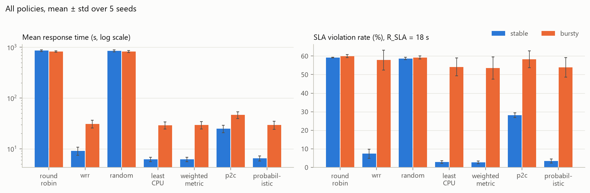
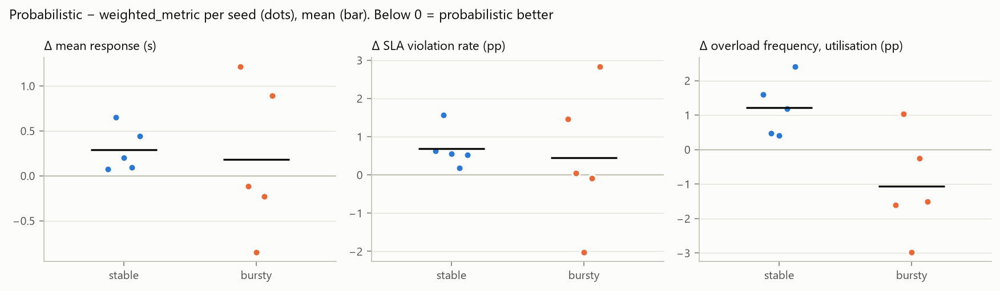
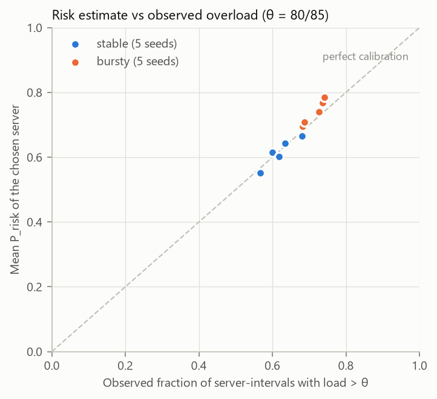
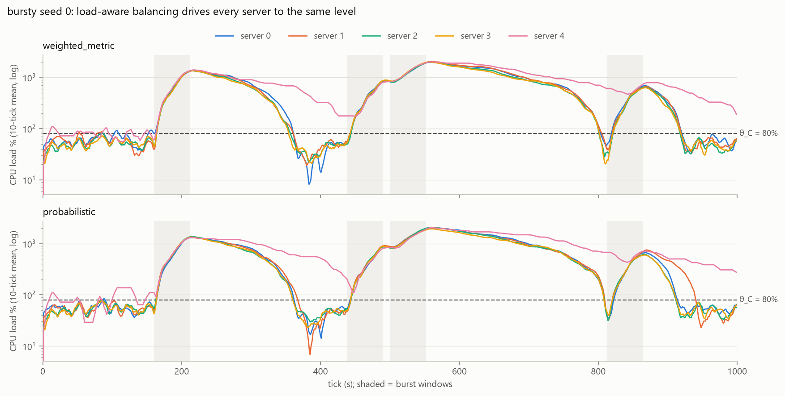
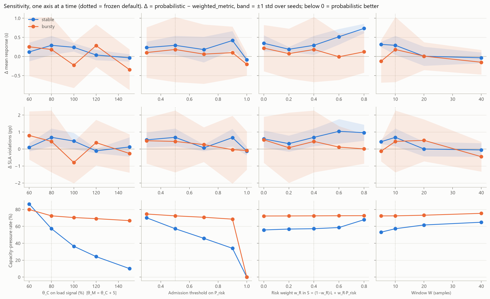
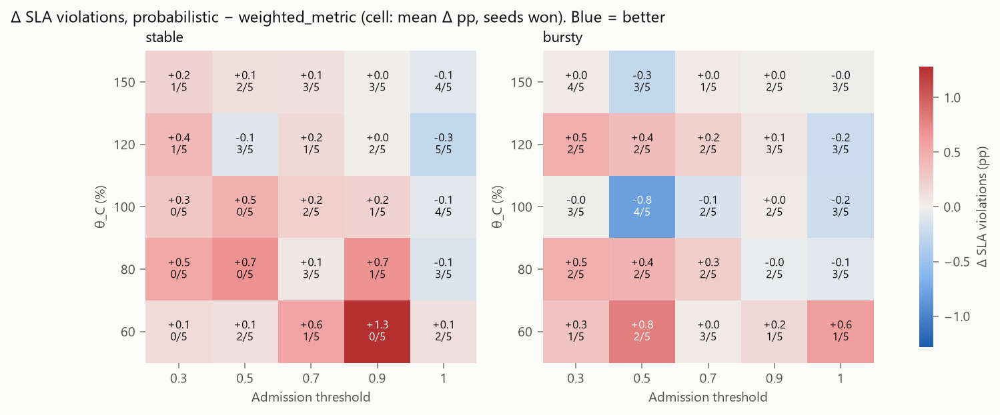

# Results

All numbers come from `python -m experiments.run_all` and `python -m experiments.sensitivity` at commit time.
The figures are snapshots in [figures/](figures/). Decision IDs (Dn) refer to [decisions.md](decisions.md).

## 1. Question and primary outcome

> Does an uncertainty-aware balancer, which scores servers by the estimated probability of exceeding a
> utilisation threshold, reduce SLA violations and overload frequency under **bursty** demand, without an
> unacceptable loss of throughput or increase in response time?

The test that answers this compares `probabilistic` against `weighted_metric`, its **one-term ablation**. The two
policies share the same load score L_i. The only differences are the P_risk term in S_i and the admission rule. A
unit test confirms that removing the risk term reproduces `weighted_metric` decision for decision. The other five
baselines give context: beating them shows that *load-awareness* helps, while beating the ablation would show
that *uncertainty* helps.

## 2. Setup

| Item | Value |
|---|---|
| Servers | 5, heterogeneous: (4c, 1.0×) ×2, (8c, 1.5×), (8c, 2.0×), (2c, 0.5×) |
| Tasks | CPU ~U(0.5, 1.5) cores, memory ~U(0.5, 3) GB, work lognormal with mean 6 s |
| Arrivals | Poisson for 1000 s, about 65% mean offered load, then drain until idle |
| Stable | ±20% sinusoidal drift |
| Bursty | 4 bursts of 50 s at 3× arrivals and 1.3× CPU; the baseline rate is scaled so mean load matches stable (D9) |
| Seeds | 0–4. Each (workload, seed) task list is shared by all 7 policies |
| Frozen parameters | θ_C 80%, θ_M 85%, W 10, S weights (0.6, 0.4), admission 0.5, R_SLA 18 s |
| Signal | load % = (running + queued demand) ÷ capacity (D19); true utilisation is used for evaluation |
| Reporting | mean ± std over seeds; per-seed paired Δ against the ablation, with win counts (D23) |

## 3. Main results

| Policy | Stable resp (s) | Stable SLA | Bursty resp (s) | Bursty p95 (s) | Bursty SLA | Bursty overload (util) |
|---|---|---|---|---|---|---|
| Round Robin | 857 ± 30 | 59.2% | 821 ± 25 | 5087 | 60.0% | 39.2% |
| Random | 847 ± 40 | 58.7% | 823 ± 35 | 5156 | 59.2% | 39.3% |
| Weighted RR | 9.1 ± 1.7 | 7.4% | 30.9 ± 5.2 | 77 | 57.8% | 48.4% |
| P2C | 24.8 ± 4.2 | 28.2% | 46.4 ± 7.3 | 149 | 58.2% | 54.6% |
| Least CPU | 6.16 ± 0.61 | 2.9% | 29.2 ± 4.8 | 82 | 54.1% | 49.6% |
| Weighted metric | 6.15 ± 0.62 | 2.7% | 29.3 ± 4.9 | 83 | 53.5% | 49.1% |
| **Probabilistic** | 6.44 ± 0.74 | 3.4% | 29.5 ± 5.2 | 85 | 53.9% | 48.0% |

Observations:

1. **Load-blind policies collapse.** Round Robin and Random give the 2-core, 0.5-speed server one fifth of the
   tasks, although it has only 1/37 of the capacity. It builds a backlog of hundreds of tasks that takes about
   7,000 s to drain. Their low "overload" figure is misleading: the other four servers sit mostly idle.
2. **CPU % alone hides backlog (D18 → D19).** Under fragmentation, a server with a 400-task queue can still show
   about 62% CPU. Every load-aware policy here observes *load* %, which counts queued demand. Without that change,
   Weighted RR beat all of them.
3. **P2C is weak with N = 5.** A two-server sample misses the fastest server (16 of 37 capacity units) 60% of the
   time. P2C's advantages appear with many servers and stale information, and neither applies here.
4. **Bursts overwhelm every policy.** Over half of all tasks violate the SLA under every policy, because offered
   load is about 160% of capacity during a burst. The differences among the load-aware policies are a few percent.

## 4. The ablation: does P_risk help?

| Workload | Metric | Δ = prob − WM (mean ± std) | Seeds won by prob |
|---|---|---|---|
| stable | mean response | +0.29 s ± 0.25 | 0/5 |
| stable | SLA violation rate | +0.69 pp ± 0.52 | 0/5 |
| stable | overload (util) | +1.2 pp ± 0.8 | 0/5 |
| bursty | mean response | +0.18 s ± 0.85 | 3/5 |
| bursty | SLA violation rate | +0.45 pp ± 1.8 | 2/5 |
| bursty | overload (util) | −1.1 pp ± 1.5 | 4/5 |
| bursty | throughput | +0.001 /s ± 0.075 | 1/5 (2 ties) |

**Verdict: the primary outcome is not met.** On stable, the risk term is slightly but consistently harmful
(0/5 wins; a sign test gives p = 1/32 ≈ 0.03). On bursty, the differences are well inside seed-to-seed noise. The
one favourable number, a 1.1 pp drop in bursty overload, is smaller than its own standard deviation.

## 5. Why: calibrated but not discriminative

The risk model is **not wrong**. The mean P_risk of the chosen server matches the observed frequency with which
the load signal exceeds θ: 0.62 vs 0.62 on stable and 0.74 vs 0.72 on bursty. Points lie on the y = x line.

The model is *useless for ranking*, though. A load-aware balancer equalises the observed signal across servers,
so they rise and fall together. During a burst, all five reach 10–20× capacity at once. Every server has
P_risk ≈ 1, and the admission rule finds no eligible server, so the decision is logged as **capacity pressure**:
57% of decisions on stable and 73% on bursty. S_i then ranks the same way as L_i. Variance can only add
information when servers *differ* in volatility at a similar mean, and a load-aware balancer erodes exactly that
difference (D21).

## 6. Sensitivity analysis

Design (D26): each pre-declared axis is varied alone around the frozen defaults, and one θ × admission grid is
added. At every point, the ablation is **rerun under the same config**, so Δ still isolates the risk term.
Outcomes are always scored at the frozen θ = 80/85 and R_SLA, so that moving a knob cannot also move the yardstick.

| Axis | Values | Finding |
|---|---|---|
| θ_C (θ_M = θ_C + 5) | 60–150 | A higher θ cuts stable capacity pressure from 57% to 10%, and Δ shrinks to ≈ 0 without becoming a consistent win. Bursty pressure stays at 67–80% at every θ, and bursty Δ changes sign with no trend. |
| Admission threshold | 0.3–1.0 | The only consistent pattern. At 1.0 (no filtering), stable is −0.08 s with 5/5 wins and bursty is −0.20 s with 4/5: a ~1% effect. **The admission rule is the component that hurts.** |
| Risk weight w_R | 0–0.8 | Stable gets steadily worse as w_R grows (+0.19 → +0.73 s, 0/5 everywhere). Bursty stays flat around 0. |
| Window W | 5–40 | W = 40 is marginally better than W = 10 (3–4/5 wins), inside the noise. |

The grid shows no region of consistent improvement. Its best bursty cell (θ 100, admission 0.5: −0.8 pp SLA,
4/5) has worse neighbours on every side. Among about 50 cells, a few 4/5 or 5/5 cells are expected by chance
(p ≈ 0.03 each), so a cell only counts if it fits a trend along its axis.

**Pattern:** every setting that helps does so by *weakening* the risk machinery, moving the policy back toward
the ablation. The null result holds across the whole swept range (D27). The defaults were not retuned.

## 7. Threats to validity

- **Distributional assumption.** Φ assumes the metric is normal. The load signal is non-negative, skewed,
  autocorrelated and regime-switching, and only 10 samples are used. Calibration was still good, because the
  *level* relative to θ dominates the outcome, but the tail estimates during transitions are crude.
- **Independence.** `1 − (1−P_C)(1−P_M)` assumes CPU and memory are independent. Queued load couples them, so the
  formula overestimates the union probability. The true value lies between max(P_C, P_M) and P_C + P_M.
- **Backward-looking risk.** P_risk is computed from the window, not from the state after the candidate task is
  placed. It lags by up to one tick.
- **Synthetic workload.** Demands are drawn independently from fixed distributions, and bursts hit every server
  equally. Real traces (Google cluster data, Alibaba) have per-tenant correlation and heterogeneous volatility,
  which is exactly the regime where variance *could* discriminate.
- **Scale.** 5 servers and 5 seeds. Effects below about 1% cannot be resolved, and small-N effects (P2C) do not
  generalise.
- **Discretisation.** Whole-tick reservation inflates effective load by about 10% (D15). It is identical for all
  policies, so comparisons are fair, but absolute numbers are slightly pessimistic.
- **Hand-picked weights.** The sensitivity sweep covers this one axis at a time, but not a full joint optimisation.

## 8. Conclusions and future work

1. Load-aware balancing that **includes queued demand** is the dominant factor here, worth two orders of magnitude
   in response time.
2. Adding a variance-based overload probability to a good load-aware score did **not** improve SLA violations,
   overload or response time, under either workload or any swept setting. The estimate was calibrated but
   non-discriminative, because the balancer makes every server look alike.
3. The hard admission filter was mildly harmful. A small risk term inside the score was neutral.

Directions where uncertainty could plausibly help:
- **Servers with different volatility,** e.g. co-located noisy neighbours or tenants with different burstiness.
  The hypothesis predicts gains there, and this setup does not contain them.
- **Prediction after assignment:** estimate P_risk for the state *after* adding the task, so the score responds to
  the decision being made.
- **Stale or sampled metrics,** as in real systems scraping Prometheus every 15 s. Variance then quantifies
  uncertainty about the *current* state, not only future fluctuation.
- **Better risk models:** an empirical exceedance rate, EWMA mean and variance, or a joint CPU and memory model
  with correlation.
- **Real traces** and larger clusters, with more seeds to resolve effects around 1%.
